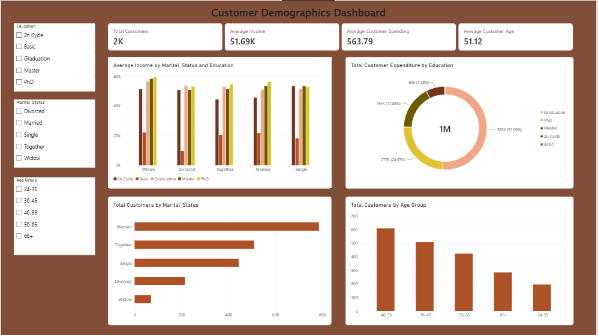
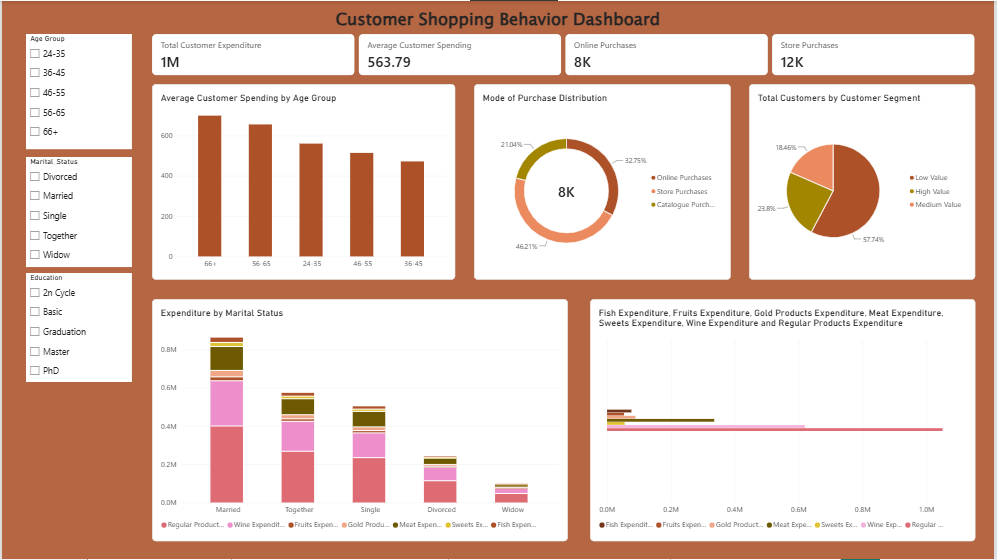
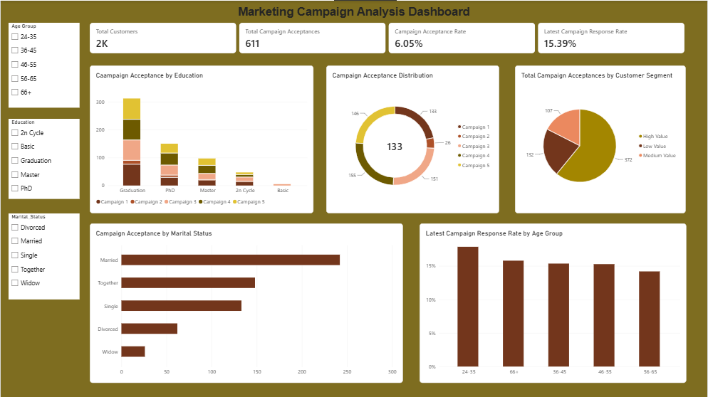
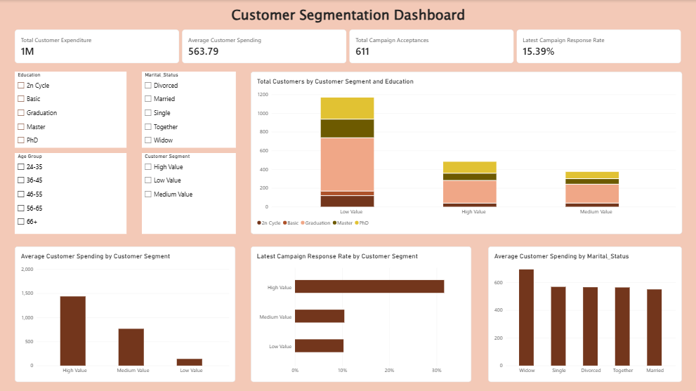

# Customer Segmentation & Marketing Campaign Analysis (Power BI)

An interactive 4-page Power BI report that analyses 2,205 customer records from a food retailer's marketing dataset. It covers who the customers are, what and how they buy, how they segment by value, and how well past marketing campaigns performed.

## Project files

| File | Contents |
|---|---|
| Marketing_Analysis_Dataset.csv | Raw customer dataset (2,205 rows, 39 columns) |
| Customer_Segmentation_And_Marketing_Campaign_Analysis.pbix | Power BI report: data model, DAX measures, 4 dashboard pages |
| 1_customer_overview.PNG, 2_product_purchasing.PNG, 3_campaign_performance.png, 4_customer_segmentation.png | Screenshots of the 4 report pages |

## Dataset

Each row is one customer. Main fields:

| Group | Columns |
|---|---|
| Demographics | Age, Income, Kidhome, Teenhome, marital status (5 columns), education (5 columns) |
| Spending (per category) | MntWines, MntFruits, MntMeatProducts, MntFishProducts, MntSweetProducts, MntGoldProds, MntTotal |
| Purchase channels | NumWebPurchases, NumCatalogPurchases, NumStorePurchases, NumDealsPurchases, NumWebVisitsMonth |
| Campaigns | AcceptedCmp1 to AcceptedCmp5, Response (latest campaign), AcceptedCmpOverall |
| Other | Recency (days since last purchase), Customer_Days, Complain |

## Data preparation

| Observation | Note |
|---|---|
| Marital status and education stored as 5 separate 0/1 columns each | Combined into single Marital_Status and Education fields for slicing and charts |
| Age Group and Customer Segment (Low / Medium / High Value) | Created as new fields for segmentation |
| 184 rows are exact duplicates (8.3%) | The data has no customer ID, so they cannot be confirmed as true duplicates |
| 3 rows have a negative MntRegularProds | Gold-product spend exceeds total spend in those rows |
| Z_CostContact (always 3) and Z_Revenue (always 11) | Constant columns, no analytical value |
| 20 customers have a complaint on record | Too few to analyse separately |

## DAX measures

| Measure | Definition |
|---|---|
| Total Customers | Count of customer rows |
| Total Customer Expenditure | Sum of MntTotal |
| Average Customer Spending | Total Customer Expenditure / Total Customers = 1,240,896 / 2,205 = 562.76 |
| Average Income, Average Customer Age | Averages of Income and Age |
| Online / Store / Catalogue Purchases | Sums of NumWebPurchases, NumStorePurchases, NumCatalogPurchases |
| Wine, Meat, Fish, Fruits, Sweets, Gold, Regular Products Expenditure | Sums of each spending column |
| Total Campaign Acceptances | Sum of AcceptedCmp1 to AcceptedCmp5 = 660 |
| Latest Campaign Response Rate | Response customers / Total Customers = 333 / 2,205 = 15.1% |

## Dashboard pages

1. **Customer Overview:** KPI cards (customers, average age, income, spending), customers by age group and marital status, expenditure by education, average income by education and marital status.
2. **Product & Purchasing Behaviour:** KPI cards, expenditure by product category, mode-of-purchase distribution (store / online / catalogue), expenditure by marital status, average spending by age group.
3. **Marketing Campaign Performance:** acceptance rate and response KPIs, acceptance across Campaigns 1 to 5, acceptance by education and marital status, response rate by age group, acceptances by customer segment.
4. **Customer Segmentation:** customers by segment and education, average spending and campaign response rate by segment, spending by marital status.

All pages are filtered with slicers for Age Group, Education and Marital Status. The segmentation page also has a Customer Segment slicer.

## Key results

| Metric | Value |
|---|---|
| Customers | 2,205 |
| Total expenditure | 1,240,896 |
| Average spend per customer | 562.76 |
| Average income | 51,622 |
| Average age | 51 |
| Latest campaign response rate | 15.1% (333 customers) |
| Total acceptances, Campaigns 1 to 5 | 660 |

## Insights

### 1. Wine and meat drive spending

| Category | Total spend | Share |
|---|---|---|
| Wines | 675,093 | 50.5% |
| Meat | 364,513 | 27.2% |
| Gold products | 97,146 | 7.3% |
| Fish | 83,253 | 6.2% |
| Sweets | 59,818 | 4.5% |
| Fruits | 58,219 | 4.4% |

Wine and meat together are (675,093 + 364,513) / 1,240,896 = 83.8% of all spending.

### 2. Stores are the main sales channel

Out of 27,716 purchases, stores account for 12,841 (46.3%), the website 9,042 (32.6%) and the catalogue 5,833 (21.0%). Customers who spend more visit the website less often (correlation between spend and monthly web visits is −0.50), so heavy spenders buy mainly in store and by catalogue.

### 3. Income and household size are the strongest spending drivers

- Correlation between income and total spend is 0.82.
- Average spend falls as children are added to the household: 1,041 with no kids, 435 with one and 222 with two.
- Deal purchases rise with kids: 1.13 per customer with no kids, 2.47 with one and 3.57 with two.

| Income quartile | Avg spend | Latest campaign response |
|---|---|---|
| Lowest 25% (up to 35,196) | 65 | 10% |
| 25% to 50% | 202 | 13% |
| 50% to 75% | 691 | 10% |
| Top 25% (above 68,281) | 1,294 | 27% |

### 4. A small group of customers produces most of the revenue

When customers are ranked by total spend and split into thirds:

| Spend group | Customers | Avg spend | Share of total spend | Latest campaign response |
|---|---|---|---|---|
| High | 734 | 1,277 | 75.6% | 24.9% |
| Medium | 734 | 372 | 22.0% | 12.5% |
| Low | 737 | 41 | 2.5% | 7.9% |

The top 20% of customers account for 53.6% of all spending.

### 5. Education and marital status shape response

| Education | Customers | Avg income | Avg spend | Latest campaign response |
|---|---|---|---|---|
| PhD | 476 | 55,220 | 640 | 21.2% |
| Master | 364 | 52,630 | 571 | 15.4% |
| Graduation | 1,113 | 51,984 | 571 | 13.7% |
| 2n Cycle | 198 | 47,625 | 452 | 11.1% |
| Basic | 54 | 20,306 | 59 | 3.7% |

Single (22.9%), divorced (20.9%) and widowed (23.7%, only 76 customers) customers respond about twice as often as married (11.5%) and together (10.6%) customers, even though average spend is similar across all groups.

### 6. Campaign performance

| Campaign | Accepted | Rate |
|---|---|---|
| Campaign 1 | 142 | 6.4% |
| Campaign 2 | 30 | 1.4% |
| Campaign 3 | 163 | 7.4% |
| Campaign 4 | 164 | 7.4% |
| Campaign 5 | 161 | 7.3% |
| Latest campaign | 333 | 15.1% |

- The latest campaign got about twice the response of any earlier one, while Campaign 2 performed worst.
- Customers who respond spend far more (924 vs 498 on average) and have accepted more earlier campaigns (0.99 vs 0.18 on average).
- Recency matters: 29.3% of customers who bought in the last 20 days responded, against 6.7% of those who last bought 80 or more days ago.

## Recommendations

1. Focus retention and loyalty offers on the high-value group, which produces about three-quarters of revenue.
2. Build wine and meat bundles and promotions, since they carry 84% of spending.
3. Target campaigns at recent buyers, high-income customers and past responders, where response rates are highest.
4. Use deal-based offers for families with children, who buy more on deals but spend less overall.
5. Test what made the latest campaign work and reuse it, and review or retire the Campaign 2 approach.
6. Invest in store and catalogue experiences for high spenders, who visit the website the least.

## Limitations

- The dataset has no customer ID or purchase dates, so duplicates and time trends cannot be checked.
- Some groups are small (Basic education, 54 customers; widowed, 76 customers), so treat their rates with care.
- Correlations show association, not cause.
- Results describe this dataset only and may not generalise to other customers.

## Tools & skills demonstrated

Power BI, DAX measures, data modelling, data cleaning, customer segmentation, campaign analysis, dashboard design, business insights and reporting.
